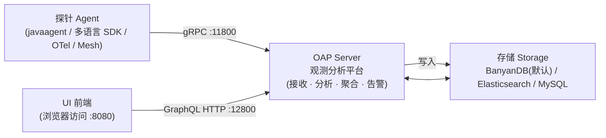
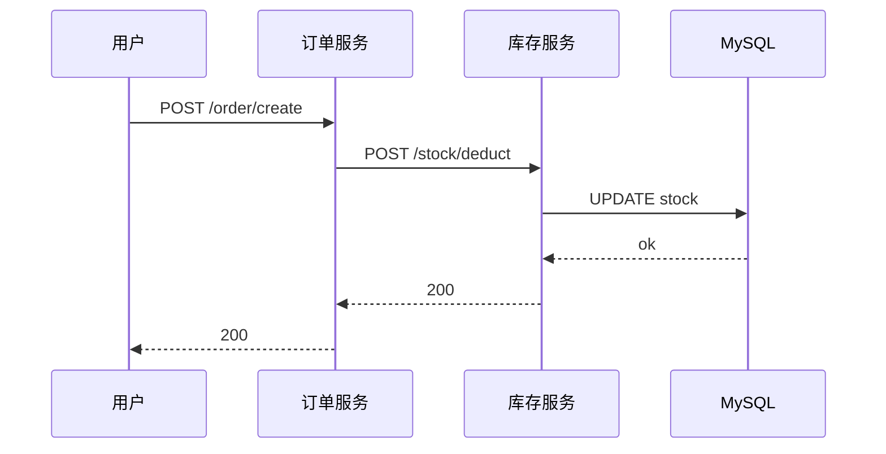

# 第 1 篇 · 认识 SkyWalking

> 本篇不需要你写任何代码。读完你将明白：为什么需要 SkyWalking，它由哪些组件组成，Trace / Span / Segment 这些概念到底指什么，以及它和 Zipkin、Jaeger、Prometheus 是什么关系。

---

## 一、从一个常见的崩溃现场说起

假设线上有一个订单系统，拆成了 5 个微服务：

```
网关 → 订单服务 → 库存服务 → 支付服务 → MySQL
```

某个下午，用户反馈"下单很慢，偶尔还失败"。你打开各个服务的日志：

- 订单服务说：我调库存服务超时了；
- 库存服务说：我的接口 300ms 就返回了，没问题；
- 支付服务说：这跟我没关系；
- MySQL 说：我没有慢查询。

每台机器的日志都是孤立的——你**无法知道同一个用户请求到底在这条调用链上经历了什么**，哪一段慢、哪一段抛了异常、重试了几次。在微服务架构下，"看单机日志"这种方式已经失效，这正是 **APM（Application Performance Monitoring，应用性能监控）** 要解决的问题。

APM 工具会做三件事：

1. **把一次请求经过的所有服务、所有方法串成一条链路**（分布式链路追踪，Tracing）；
2. **持续统计每个服务/接口的调用量、响应时间、错误率**（指标，Metrics）；
3. **把链路与日志关联起来**，出了问题能快速定位到具体服务、具体方法、具体日志。

SkyWalking 就是一个把这三件事都做了的开源 APM 平台，而且它还提供了全局拓扑图、告警、性能剖析等能力。

## 二、SkyWalking 是什么

[Apache SkyWalking](https://skywalking.apache.org/) 是一个开源的**可观测性（Observability）平台**，用于采集、分析、聚合和可视化分布式系统的数据（链路、指标、日志）。

几个值得了解的背景：

- **Apache 软件基金会顶级项目**，Apache 2.0 开源协议，可免费商用；
- 由国人主导创建（吴晟），**中文文档和中文社区资料非常丰富**，国内互联网公司使用极广；
- 对 **Java 生态支持最完善**：Spring Boot / Spring Cloud / Dubbo / Tomcat / MySQL / Redis / Kafka / RocketMQ 等上百个组件可以**零代码接入**——加一个 JVM 启动参数即可，不用改一行业务代码；
- 同时支持多语言（Go、Python、Node.js、.NET、PHP 等）、Service Mesh（Istio/Envoy）、OpenTelemetry 数据接入、浏览器前端监控；
- 自带专门的时序数据库 **BanyanDB** 作为默认存储，也可以用 Elasticsearch / MySQL 等作为存储后端。

一句话总结：**SkyWalking ≈ 给分布式系统装上一台"CT 机"——任何一个用户请求进来，从入口到出口每一层干了什么、花了多少时间、哪里出了错，全部可视、可查、可告警。**

## 三、整体架构：四个组件

SkyWalking 整体由 4 个部分组成，数据自左向右流动：



| 组件 | 作用 | 类比 |
| --- | --- | --- |
| **Agent（探针）** | 运行在你的业务进程里，自动采集方法调用、耗时、异常，上报给 OAP | 手术用的"内窥镜"，插在应用身上 |
| **OAP Server** | 核心服务端：接收探针数据、做流式分析（算指标）、聚合拓扑、触发告警，对外提供查询接口 | "大脑" |
| **Storage（存储）** | 存放分析结果和链路明细。默认 **BanyanDB**（SkyWalking 自研的观测数据库，开箱即用）；大规模场景可换 Elasticsearch | "病历库" |
| **UI** | Web 界面：拓扑图、链路查询、指标面板、日志、告警 | "阅片屏" |

你需要记住的**端口**（后续搭建时会反复用到）：

| 端口 | 归属 | 用途 |
| --- | --- | --- |
| **11800** | OAP | gRPC 接收端口，**探针把数据上报到这里** |
| **12800** | OAP | HTTP 端口，UI 查询（GraphQL）走这里 |
| **8080** | UI | 浏览器访问的界面端口 |
| 17912 / 17913 | BanyanDB | 存储的 gRPC / HTTP 端口 |

> 部署上可以很简单：一台 2C4G 的机器就能把 OAP + UI + BanyanDB 全跑起来，用于学习和中小规模生产；大规模场景下 OAP 可以集群化、存储换 ES，这在第 4 篇生产实践里讲。

## 四、核心概念：Trace、Span、Segment

这是全系列最重要的 5 分钟。**所有 APM 工具的界面，都是围绕这几个概念组织数据的**，现在花点时间搞懂，后面看 UI 就不会懵。

### 4.1 Trace（链路）

一次请求从进入系统到离开系统，**全程**算一条 Trace。它有一个全局唯一的 **TraceId**，同一个 Trace 上的所有节点（服务、线程、消息队列消费端……）都携带这个 TraceId——这就是"把散落在各处的日志串起来"的钥匙。

### 4.2 Span（跨度）

一条 Trace 由多个 **Span** 组成。一个 Span 代表"一次有始有终的操作"：一次 HTTP 请求、一次 RPC 调用、一次 SQL 执行、一次方法调用。Span 记录：

- 操作名（如 `GET /order/create`、`MySQL/INSERT`）
- 开始时间和耗时
- 所属服务、所在层
- Tag 标签（如 `http.status_code=200`、`db.statement=select ...`）
- 是否出错（error 状态）

SkyWalking 把 Span 分为三类，看链路详情页时会用到：

| 类型 | 含义 | 例子 |
| --- | --- | --- |
| **Entry Span** | 一次请求**进入**某个服务的第一个操作 | Tomcat 收到 HTTP 请求；Dubbo Provider 收到调用 |
| **Local Span** | 服务**内部**的本地方法调用 | 某个 Service 方法里的业务逻辑 |
| **Exit Span** | 请求**离开**当前服务的操作 | 调下游服务的 HTTP 客户端、发 SQL、发 MQ 消息 |

### 4.3 Segment（分段）

Trace 是跨进程的，而 Span 是跨线程/跨服务的。**Segment = 同一个进程内的一组 Span**。一条 Trace = 多个 Segment（每个服务至少一个），多个 Segment 靠 TraceId + 跨进程上下文（SkyWalking 通过 HTTP 头 `sw8` 等）拼在一起。

### 4.4 一个完整例子

用户调用 `POST /order/create`，订单服务再调用库存服务，库存服务查了一次 MySQL：



这条 Trace 在 SkyWalking 里长这样（Span 树）：

```text
TraceId: 3f2a...e91          总耗时 120ms
└─ [订单服务] POST /order/create                  120ms   ← Entry Span
   ├─ [订单服务] OrderService.create()             95ms   ← Local Span
   │  └─ [订单服务] → POST /stock/deduct          90ms   ← Exit Span（调用下游）
   │     └─ [库存服务] POST /stock/deduct         88ms   ← 库存服务的 Entry Span（新 Segment）
   │        └─ [库存服务] MySQL UPDATE stock      60ms   ← Exit Span
   └─ [订单服务] MySQL INSERT order                10ms   ← Exit Span
```

在 UI 的链路详情页里，你会看到的就是这棵树：每一行一个 Span，颜色/图标区分服务，标红的是出错的 Span。排查"下单慢"时，一眼就能看出 120ms 里 60ms 花在库存服务的 SQL 上。

### 4.5 服务与服务实例

- **Service（服务）**：UI 上最顶层的一行，就是你在探针里配置的 `service_name`，比如 `order-service`；
- **Service Instance（服务实例）**：同一个服务的一个具体进程（一台机器/一个 Pod）。多实例部署时，UI 能分别展示每个实例的负载、JVM 指标（Java 应用自动上报 CPU / 堆内存 / GC）；
- **Endpoint（端点）**：服务对外的具体入口，如 `POST /order/create`，UI 会统计每个 Endpoint 的调用量、平均耗时、错误率。

### 4.6 采样（Sampling）

生产环境流量大，探针可以选择只上报一部分 Trace（如每 3 秒采样 N 条）。**指标和拓扑不受采样影响**（它们由全量数据聚合），采样的只是链路明细。默认全采样，第 4 篇会讲如何调整。

## 五、SkyWalking 能监控什么（能力全景）

| 能力 | 说明 |
| --- | --- |
| **分布式链路追踪** | Trace/Span 全景、耗时瀑布图、错误定位、跨线程/跨进程上下文传播 |
| **全局拓扑** | 自动生成服务依赖拓扑图，标出调用关系和每条边的 QPS/耗时/错误率 |
| **指标看板** | 服务/实例/端点三个层级的调用量、响应时间、SLA；Java 进程的 JVM 指标自动上报 |
| **日志关联** | 业务日志自动带上 TraceId，可上报到 SkyWalking 在链路下直接查看（第 4 篇实战） |
| **告警** | 按指标规则告警（响应时间、成功率……），支持 Webhook / 钉钉 / 微信等通知渠道 |
| **性能剖析（Profile）** | 对指定端点做方法级的 CPU 采样分析，定位"代码哪一行慢"，无需改代码 |
| **生态接入** | OpenTelemetry（OTLP）、Istio/Envoy Service Mesh、Zipkin v2 格式、Prometheus 数据等 |
| **前端/小程序监控** | 浏览器 JS、微信/支付宝小程序、iOS 的性能与错误监控 |

## 六、与同类工具的关系

新手常见的困惑："已经有 Zipkin / Jaeger / Prometheus 了，为什么还要 SkyWalking？"

| 对比项 | SkyWalking | Zipkin / Jaeger | Pinpoint |
| --- | --- | --- | --- |
| 定位 | 全能可观测平台（Trace+Metrics+Log+告警） | 专注分布式链路追踪 | APM（Java 强） |
| Java 接入 | javaagent 零侵入，插件极多 | 需引入 SDK/桥接（Brave/Micrometer） | javaagent 零侵入 |
| 指标看板 | 内置，开箱即用 | 无，需配合 Prometheus + Grafana | 内置 |
| 告警 | 内置 | 无 | 弱 |
| 拓扑图 | 内置，自动 | 需额外组件 | 有 |
| 存储 | BanyanDB（默认）/ ES / MySQL | ES / Cassandra / 内存 | HBase |
| UI 语言生态 | 中文社区活跃 | 国际 | 韩系，资料偏旧 |

- **与 Prometheus + Grafana 的关系**：互补而非替代。Prometheus 擅长基础架构/中间件指标；SkyWalking 强在"以应用为中心、指标与链路与日志关联"。SkyWalking 也内置了 Prometheus 指标的接收能力。
- **与 OpenTelemetry 的关系**：OTel 是"采集标准"，SkyWalking 是"分析平台"。SkyWalking 可以直接接收 OTLP 数据（OTel SDK、OTel Collector 推过来的 Trace/Metric/Log），因此"用 OTel 埋点 + SkyWalking 做后端"也是常见架构。Java 场景下 SkyWalking javaagent 的开箱即用程度仍然明显高于手写 OTel 埋点。

## 七、版本现状（截至 2026 年 11 月）

- **10.x 稳定线**：当前最新 10.4.0。默认存储为 BanyanDB（10.2.0 起 H2 已被永久移除）。**本系列教程主线**。
- **11.x（2026-08 起）**：重大变化——不再内置 Web UI，UI 改为独立发布的 **Horizon UI**（`apache/skywalking-ui` 镜像，端口 17128）；新增 admin-server（17128/17129，默认无鉴权，需网关保护）；BanyanDB 需 0.11.x。学习/体验建议仍从 10.x 开始，升级注意事项见第 2 篇。
- **Java Agent**：9.8.0，支持 JDK 8 ~ 25，与 OAP 9.7+ / 10.x / 11.x 均可配合使用。

## 八、小结

- SkyWalking 是开源 APM / 可观测性平台：**Agent 采集 → OAP 分析 → BanyanDB/ES 存储 → UI 展示**；
- 探针上报走 **gRPC 11800**，UI 查询走 **HTTP 12800**，界面端口 **8080**；
- 核心数据模型：**Trace（一条请求的全旅程）→ Segment（一个进程内的一段）→ Span（一个操作）**，服务/实例/端点是三个统计维度；
- Java 应用接入的核心是 **javaagent 字节码增强**，不改业务代码。

下一篇我们动手把 SkyWalking 环境搭起来（Windows / Docker / Linux 三条路线任选）。

---

*导航：[README](README.md) · 上一篇：无 · 下一篇：[02-搭建环境](02-搭建环境.md)*
