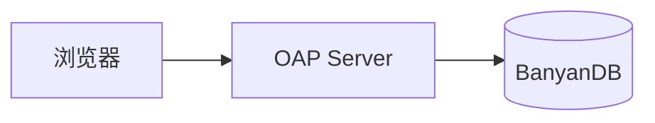

# SkyWalking 从零到一 · 系列教程

> 面向**从未使用过 SkyWalking 的开发人员**，从概念、环境搭建到程序接入与生产实践，一步一个脚印讲清楚。
> 本站基于 [VitePress](https://vitepress.dev/) 构建。

## 本地运行

需要 Node.js 18+。

```bash
npm install          # 安装依赖
npm run docs:dev     # 本地预览 http://localhost:5173
npm run docs:build   # 构建静态站点，产物在 docs/.vitepress/dist
npm run docs:preview # 预览构建产物
```

## 目录结构
```
.
├─ docs/                      # 站点源码（VitePress 根目录）
│  ├─ .vitepress/
│  │  ├─ config.mts           # 站点配置：标题、导航、侧边栏、搜索
│  │  └─ theme/index.ts       # 自定义主题：接入 Mermaid 渲染器与工具栏
│  ├─ public/                 # 静态资源（favicon 等）
│  ├─ index.md                # 首页
│  ├─ 404.md                  # 404 页面
│  ├─ 01-认识SkyWalking.md
│  ├─ 02-搭建环境.md
│  ├─ 03-Java应用接入.md
│  ├─ 04-进阶功能与生产实践.md
│  └─ 05-多语言接入概览.md
├─ .github/workflows/deploy.yml  # 推送 main 后自动构建并发布到 GitHub Pages
├─ netlify.toml                  # Netlify 部署配置（构建命令、产物目录）
├─ package.json
└─ README.md
```

## Mermaid 图表

接入 [`vitepress-mermaid-renderer`](https://github.com/sametcn99/vitepress-mermaid-renderer)：页面里写普通 ```mermaid 代码块，构建后自动渲染成可交互图表，**每张图右下角带一条工具栏**。

| 按钮 | 作用 |
| --- | --- |
| 放大 / 缩小 | 0.2x ~ 10x 缩放，中间显示当前百分比 |
| 重置视图 | 恢复缩放与平移 |
| 复制源码 | 复制该图的 mermaid 源码 |
| 下载图片 | 导出 PNG |
| 全屏查看 | 弹窗模式放大查看 |
| 收起工具栏 | 折叠成一个小箭头 |

用法示例：

````md

````

实现要点：

- 编辑器在 `docs/.vitepress/theme/index.ts`，工具栏文案已汉化，桌面 / 移动端 / 全屏三套按钮配置可分别调整。
- mermaid 主题跟随 VitePress 明暗模式：切换深浅色时通过 `MutationObserver` 调用 `setConfig({ theme })` 重新渲染，避免深色页面出现白底图。
- 图表库按需异步加载（约 1 MB 的独立 chunk），不影响正文首屏速度；加载失败只丢图表、不影响阅读。
- 宽图可用工具栏缩放或全屏查看，不必改正文排版。

## 部署

站点的 `base` 由环境变量 `DOCS_BASE` 控制：默认 `/`（Netlify、自有域名），GitHub Pages 项目站点构建时设为 `/skywalking-tutorial/`。

### Netlify

`netlify.toml` 已配置好，Netlify 侧只需关联本仓库，无需手动填命令：

| 配置项 | 值 |
| --- | --- |
| Build command | `npm run docs:build`（由 netlify.toml 提供） |
| Publish directory | `docs/.vitepress/dist`（由 netlify.toml 提供） |
| Node 版本 | 20（由 netlify.toml 提供） |
| 环境变量 | 无需设置（`DOCS_BASE` 留空即为根路径） |

### GitHub Pages

`Settings → Pages → Source` 选择 **GitHub Actions**，推送 `main` 后由 `.github/workflows/deploy.yml` 自动构建发布，构建时自动带上 `DOCS_BASE=/skywalking-tutorial/`。

## 系列目录

| 篇章 | 文件 | 内容 |
| --- | --- | --- |
| 第 1 篇 | [docs/01-认识SkyWalking.md](docs/01-认识SkyWalking.md) | 是什么、为什么需要、架构组成、核心概念（Trace/Span/Segment）、与同类工具对比 |
| 第 2 篇 | [docs/02-搭建环境.md](docs/02-搭建环境.md) | Windows 本地直装 / Docker Compose / Linux 服务器三条路线，BanyanDB 存储配置，验证清单 |
| 第 3 篇 | [docs/03-Java应用接入.md](docs/03-Java应用接入.md) | javaagent 原理、Spring Boot 双服务实战、IDEA/命令行接入、UI 上验证链路、排错 |
| 第 4 篇 | [docs/04-进阶功能与生产实践.md](docs/04-进阶功能与生产实践.md) | UI 深入、自定义埋点（@Trace）、日志带 traceId、告警规则、采样、TTL、生产建议 |
| 第 5 篇 | [docs/05-多语言接入概览.md](docs/05-多语言接入概览.md) | Node.js / Go / Python 接入、OpenTelemetry、Service Mesh、前端监控 |

## 版本约定（教程写作时点：2026 年 11 月）

| 组件 | 版本 | 说明 |
| --- | --- | --- |
| OAP Server（apache-skywalking-apm） | **10.4.0** | 10.x 稳定线最后一版，**内置 Web UI**，新手体验最顺 |
| Java Agent（apache-skywalking-java-agent） | **9.8.0** | 支持 JDK 8 ~ 25；OAP 发行包内也自带 agent，可单独升级 |
| BanyanDB（默认存储） | **0.10.x** | 与 OAP 10.4.0 配套（API 版本 0.10）；**不要**用 0.11.x 配 10.4.0 |
| JDK（跑 OAP / UI） | 17（11/21/25 亦可） | 业务应用侧 JDK 8+ 均可接 agent |

> ⚠️ **为什么不用最新的 11.x？** SkyWalking 11.0（2026-08 发布）起不再内置 Web UI，改为独立发布的
> Horizon UI（Docker 镜像 `apache/skywalking-ui`，端口 17128），并新增无鉴权的 admin-server（17128/17129）。
> 新手用 10.x 学习成本最低；11.x 的差异与升级注意事项见
> [02-搭建环境.md 的「11.x 变化速览」](docs/02-搭建环境.md)。

## 全系列约定

- Windows 示例统一把 SkyWalking 解压到 `D:\skywalking\`；Linux 示例统一放 `/opt/skywalking/`
- 演示应用为两个 Spring Boot 服务：`service-a`（8081）→ `service-b`（8082），注意避开 UI 的 8080
- 所有链接与版本号以[官方下载页](https://skywalking.apache.org/downloads)和[官方文档](https://skywalking.apache.org/docs/)为准

## 官方资源

- 下载页：https://skywalking.apache.org/downloads
- 主文档：https://skywalking.apache.org/docs/#SkyWalkingAPM
- Java Agent 文档：https://skywalking.apache.org/docs/skywalking-java/latest/readme/
- GitHub：https://github.com/apache/skywalking
- 中文博客：https://skywalking.apache.org/zh/blog/
